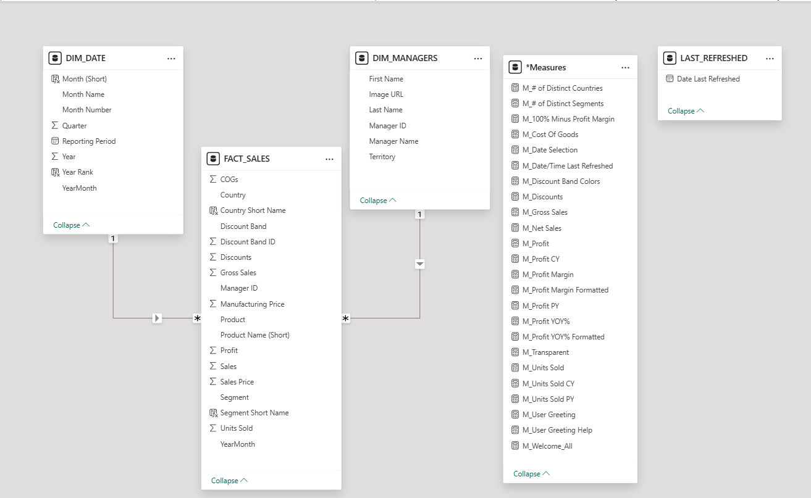

# Model explanation

The supplied diagram shows two active one-to-many, single-direction relationships: DIM_DATE → FACT_SALES and DIM_MANAGERS → FACT_SALES. The arrows point from each dimension toward the fact table. LAST_REFRESHED and *Measures appear disconnected.

Manager ID and YearMonth are the apparent relationship keys from the available fields. The diagram does not expose the exact endpoint properties, so these must be confirmed in Power BI before treating them as verified configuration. Dimension-key uniqueness and orphan fact rows have not been tested.

Country, segment, product, and discount attributes reside in FACT_SALES. The date dimension appears oriented around reporting months; do not assume a daily marked date table. Manager filtering customizes the report but does not demonstrate row-level security.

The fact table contains summarized source sales records, not verified individual orders. See the [data dictionary](../Data_Dictionary.md) and [validation checklist](../Docs/Validation.md).
