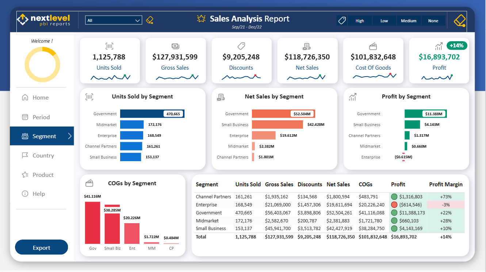
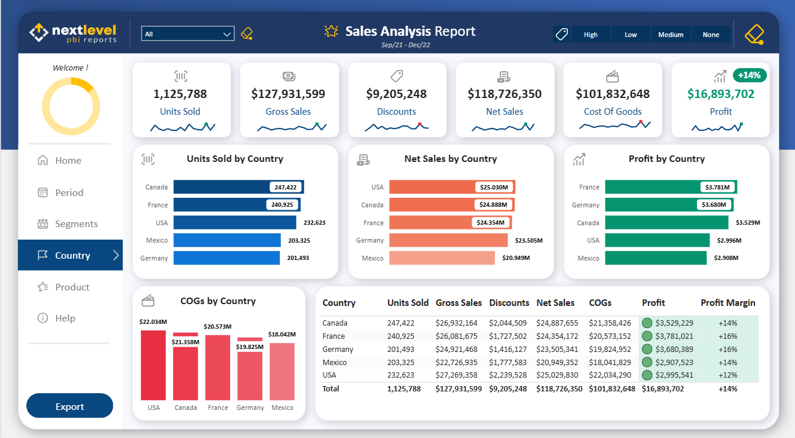

# Sales Analysis — Power BI

**Where are sales failing to translate into profit?**

Enterprise generated $19.61 million in net sales but lost $614,546. France earned more profit than the USA despite lower sales. This report explores those differences across customer segments, countries, products, and managers.

[Live dashboard](https://app.powerbi.com/view?r=eyJrIjoiY2YyNjkxMWYtMmEzNS00MTUzLWFhZDctNTQ2MmM4MTI1MzE0IiwidCI6ImIyZDQ1OTA3LTUwOWItNDQ5Ni05YmQzLTVhNjBjN2YwZjM4MCIsImMiOjN9) · [Data dictionary](Data_Dictionary.md) · [Model](Model/README.md) · [DAX documentation](Dax%20Measures/README.md) · [Validation notes](Docs/Validation.md)

## Project scope

- **Period:** September 2021–December 2022.
- **Coverage:** five customer segments, five countries, and six products.
- **Overall results:** $118.73 million in net sales and $16.89 million in profit after cost of goods.
- **Source:** sales and manager Excel files supplied through a Udemy course.

I built the Power BI report from a blank report, using Power Query, date and manager dimensions, DAX measures, and interactive report pages. The manager file included territory assignments and image URLs. Backgrounds, icons, logos, and themes came from the course materials.

The source files already contained sales, discount, cost, and profit fields. My report brings these fields into a model and adds measures and interactions for comparing performance. This is an educational portfolio project.

## Key findings

Values below use the full reporting period, all managers, and no discount-band selection. Percentages are calculated from the displayed monetary totals and rounded to one decimal place.

### 1. Enterprise was the only loss-making segment

Enterprise recorded **$19,611,694 in net sales** against **$20,226,240 in cost of goods**, leaving a **$614,546 loss** and a **−3.1% margin**. The other four segments were profitable.

**Next action:** break Enterprise down by product, country, and discount band to locate the losses. Compare selling prices and cost of goods before recommending pricing or discount changes.

### 2. France earned more profit from fewer sales than the USA

The USA led net sales at **$25.03 million**, with **$3.00 million profit** and a **12.0% margin**. France generated **$24.35 million in net sales**, but earned **$3.78 million profit** at a **15.5% margin**—**$785,480 more profit** than the USA.

**Next action:** compare the two countries' product mix, customer segments, and discount patterns. Sales rank alone would miss this profitability difference.

### 3. Paseo led profit contribution, but not profit margin

Paseo contributed **$4,797,438**, or **28.4% of total profit**. Its margin was **14.5%**, compared with **16.1% for Amarilla**. The largest profit contributor was therefore not the highest-margin product.

**Next action:** examine where Paseo generates its profit and where Amarilla's higher margin is sustained. Use both contribution and margin when assessing product priorities.

[View the product comparison](Docs/Screenshots/05-Sales-Analysis-Product.png)

## Model and report design

Date and manager dimensions filter the sales table. Country, segment, product, and discount-band attributes support comparisons within that table.

- **Period, Segment, Country, and Product views:** charts and aggregate tables for each perspective.
- **Manager selection:** filters results and updates the greeting and profile image.
- **Drill-through:** additional breakdowns for units, net sales, profit, and cost of goods.
- **Tooltips:** compact summaries, including a period profit total and Top 5 Managers.
- **Display measures:** reporting-period labels, refresh dates, greetings, margin formatting, and discount-band colors.

See the [model diagram](Model/README.md) and [measure documentation](Dax%20Measures/README.md) for the implementation details.

## Validation and limitations

The findings were checked against the live report and saved screenshots. Manager and discount filters, a profit tooltip, and two drill-through paths were also checked. The [validation record](Docs/Validation.md) lists the values and results.

**Profit in this report means net sales minus cost of goods.** It does not include a demonstrated allowance for operating expenses or tax. The figures describe the dataset; they do not show realized business improvements or explain what caused the differences.

The live **236% YoY badge is not used here** because the reporting period contains four months of 2021 and twelve months of 2022. A matching-month comparison is needed. Full source-data reconciliation and a complete model measure export remain outstanding; details and deferred interface improvements are recorded in the validation notes.

## Repository guide

| File or folder | Contents |
|---|---|
| [Data_Dictionary.md](Data_Dictionary.md) | Fields, business definitions, and display helpers |
| [Dax Measures](Dax%20Measures/README.md) | Original expressions, dependencies, and proposed corrections |
| [Model](Model/README.md) | Relationship diagram and model explanation |
| [Validation](Docs/Validation.md) | Completed checks and remaining work |
| Docs/Screenshots | Report pages, detail views, and tooltips |

This repository contains documentation, DAX expressions, and screenshots. The source workbooks and Power BI file are not included.
